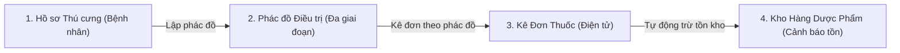

# NHẬT KÝ SỬ DỤNG TRÍ TUỆ NHÂN TẠO (AI LOGBOOK)
## PHÂN HỆ: QUẢN LÝ THÚ CƯNG, KHO HÀNG, ĐƠN THUỐC & PHÁC ĐỒ ĐIỀU TRỊ
### ĐỀ ÁN PHÁT TRIỂN ỨNG DỤNG: HỆ THỐNG QUẢN LÝ PHÒNG KHÁM THÚ Y (PETCARE POS)

---

> **Học phần:** Đề án Phát triển Ứng dụng  
> **Dự án:** Hệ thống Quản lý Phòng khám Thú y & Pet Shop (PetCare POS)  
> **Phân hệ chuyên trách:** Quản lý Thú cưng • Quản lý Kho hàng • Quản lý Đơn thuốc • Lập & Theo dõi Phác đồ Điều trị  
> **Sinh viên thực hiện:** Nguyễn Ngọc Toàn  
> **Ngôn ngữ & Nền tảng:** Java 21 • Java Swing Custom Flat UI • Microsoft SQL Server (JDBC)  
> **Kiến trúc:** 3 Lớp chuẩn (Entity – DAO – BUS – GUI)  
> **Kho mã nguồn:** [oggytriet123/de_an_phat_trien_ung_dung](https://github.com/oggytriet123/de_an_phat_trien_ung_dung) (Nhánh: `ngoc-toan`)  
> **Thời gian thực hiện:** Tháng 10/2026  

---

## MỤC LỤC
1. [TỔNG QUAN & PHẠM VI NGHIỆP VỤ 4 CHỨC NĂNG TRỌNG TÂM](#1-tổng-quan--phạm-vi-nghiệp-vụ-4-chức-năng-trọng-tâm)
2. [CÔNG CỤ AI VÀ MÔ HÌNH HỢP TÁC (AI PAIR-PROGRAMMING)](#2-công-cụ-ai-và-mô-hình-hợp-tác-ai-pair-programming)
3. [NGUYÊN TẮC VÀ KỸ THUẬT PROMPT ENGINEERING ÁP DỤNG](#3-nguyên-tắc-và-kỹ-thuật-prompt-engineering-áp-dụng)
4. [NHẬT KÝ CHI TIẾT TỪNG PHÂN HỆ CHUYÊN TRÁCH](#4-nhật-ký-chi-tiết-từng-phân-hệ-chuyên-trách)
   - [Phân hệ 1: Quản lý Thú cưng (Pet Management)](#phân-hệ-1-quản-lý-thú-cưng-pet-management)
   - [Phân hệ 2: Quản lý Kho hàng & Lịch sử Nhập - Xuất (Inventory Management)](#phân-hệ-2-quản-lý-kho-hàng--lịch-sử-nhập---xuất-inventory-management)
   - [Phân hệ 3: Quản lý Đơn thuốc & Dược phẩm (Prescription Management)](#phân-hệ-3-quản-lý-đơn-thuốc--dược-phẩm-prescription-management)
   - [Phân hệ 4: Lập & Theo dõi Phác đồ Điều trị (Treatment Protocol & Clinical Diary)](#phân-hệ-4-lập--theo-dõi-phác-đồ-điều-trị-treatment-protocol--clinical-diary)
5. [ĐÁNH GIÁ ĐỊNH LƯỢNG VÀ HIỆU QUẢ CỦA AI TRÊN 4 CHỨC NĂNG](#5-đánh-giá-định-lượng-và-hiệu-quả-của-ai-trên-4-chức-năng)
6. [THÁCH THỨC, HẠN CHẾ VÀ BÀI HỌC KINH NGHIỆM](#6-thách-thức-hạn-chế-và-bài-học-kinh-nghiệm)
7. [KẾT LUẬN VÀ ĐỊNH HƯỚNG MỞ RỘNG](#7-kết-luận-và-định-hướng-mở-rộng)

---

## 1. TỔNG QUAN & PHẠM VI NGHIỆP VỤ 4 CHỨC NĂNG TRỌNG TÂM

Trong Đề án Phát triển Ứng dụng Quản lý Phòng khám Thú y (PetCare POS), sinh viên **Nguyễn Ngọc Toàn** đảm nhiệm thiết kế kiến trúc, nghiệp vụ BUS và toàn bộ giao diện UI/UX cho **4 phân hệ cốt lõi** tạo thành một chu trình khám chữa bệnh khép kín:



### 1.1. Phạm vi nghiệp vụ của 4 phân hệ:
1. **Quản lý Thú cưng (`ThuCungPanel`):** Tiếp nhận hồ sơ thú cưng, lưu trữ ảnh đại diện, giống loài, cân nặng, tiền sử bệnh án, phân loại tình trạng sức khỏe; cung cấp lối tắt ngữ cảnh (nhấp chuột phải vào thú cưng để lập tức kê đơn hoặc tạo phác đồ điều trị).
2. **Quản lý Kho hàng (`KhoHangPanel`, `LichSuNhapXuatPanel`):** Quản lý danh mục thuốc và vật tư y tế, theo dõi số lượng tồn, cảnh báo thuốc sắp hết/hết hàng; pop-up lịch chọn ngày [`CalendarPicker.java`](file:///c:/Users/Nguyen%20Ngoc%20Toan/Downloads/de_an_phat_trien_ung_dung_full_LichHen/de_an_phat_trien_ung_dung_full/de_an_phat_trien_ung_dung_tiep_theo/src/GUI/CalendarPicker.java); tự động đồng bộ số liệu qua cơ chế Observer Pattern.
3. **Quản lý Đơn thuốc (`DonThuocPanel`):** Kê đơn thuốc điều trị trực tiếp, cho phép chọn thuốc sẵn có từ kho hàng, tự động kiểm tra số lượng tồn, cảnh báo khi xuất vượt tồn kho, liên kết trực tiếp với mã phác đồ điều trị, in đơn thuốc.
4. **Tạo & Theo dõi Phác đồ Điều trị (`PhacDoPanel`):** Thiết lập phác đồ đa giai đoạn (Giai đoạn tấn công, duy trì, phục hồi); theo dõi diễn tiến lâm sàng theo thời gian thực; thanh trượt % tiến độ tương tác; bảng nhật ký theo dõi 6 cột chuyên nghiệp; giải quyết triệt để lỗi xung đột layout giao diện.

---

## 2. CÔNG CỤ AI VÀ MÔ HÌNH HỢP TÁC (AI PAIR-PROGRAMMING)

Quá trình xây dựng 4 phân hệ được thực hiện theo mô hình **AI Pair-Programming (Lập trình cặp cùng AI)**:
- **AI Coding Assistant (Antigravity AI / Google DeepMind):** Đóng vai trò kỹ sư UI/UX và chuyên gia giải thuật Java Swing, hỗ trợ viết bộ icon vector 2D, tái cấu trúc layout chống xung đột, viết thuật toán trừ kho và quản lý commit Git.
- **ChatGPT (GPT-4o) / Claude 3.5 Sonnet:** Tham vấn cấu trúc thực thể y tế (Entity), đặc tả quy trình điều trị lâm sàng thú y và chuẩn hóa tài liệu kỹ thuật.
- **Sinh viên (Human-in-the-loop):** Xác định yêu cầu thực tế, kiểm duyệt mã nguồn, thử nghiệm trực tiếp trên máy tính (`javac --release 21`, `run.bat`), phản hồi và điều chỉnh prompt lặp.

---

## 3. NGUYÊN TẮC VÀ KỸ THUẬT PROMPT ENGINEERING ÁP DỤNG

Nhóm đã đúc kết và áp dụng 4 nguyên tắc Prompt Engineering trọng tâm cho 4 chức năng:

1. **Context-Driven Prompting (Ngữ cảnh chính xác):** Cung cấp sẵn các file `Entity`, `BUS` liên quan, bảng mã màu [`Theme.java`](file:///c:/Users/Nguyen%20Ngoc%20Toan/Downloads/de_an_phat_trien_ung_dung_full_LichHen/de_an_phat_trien_ung_dung_full/de_an_phat_trien_ung_dung_tiep_theo/src/GUI/Theme.java) để AI sinh mã nguồn tương thích 100% với hệ thống có sẵn.
2. **Constraint-Based Prompting (Ràng buộc công nghệ):**
   - Không dùng thư viện Swing bên ngoài (FlatLaf...), toàn bộ bo góc và hiệu ứng đổ bóng phải vẽ bằng `Graphics2D` khử răng cưa.
   - Bắt buộc biên dịch tương thích Java 21 (`--release 21`).
   - Mọi thao tác xuất kho thuốc từ đơn thuốc phải thread-safe và đồng bộ tức thì lên bảng kho hàng.
3. **Multimodal Debugging (Gửi ảnh chụp màn hình thực tế):** Khi gặp lỗi xung đột giao diện trong modal theo dõi diễn tiến (thành phần này đè lên thành phần kia), sinh viên chụp trực tiếp ảnh gửi cho AI để phân tích trực quan tọa độ lỗi.
4. **State Isolation Prompting (Triệt tiêu lỗi Prefilled Data):** Yêu cầu AI tách bạch hoàn toàn giữa chế độ "Thêm mới" (Form sạch) và chế độ "Chỉnh sửa" (Form nạp dữ liệu cũ), khắc phục lỗi phổ biến khi dùng chung dialog.

---

## 4. NHẬT KÝ CHI TIẾT TỪNG PHÂN HỆ CHUYÊN TRÁCH

---

### Phân hệ 1: Quản lý Thú cưng (Pet Management)
* **Các file chính phụ trách:** [`ThuCung.java`](file:///c:/Users/Nguyen%20Ngoc%20Toan/Downloads/de_an_phat_trien_ung_dung_full_LichHen/de_an_phat_trien_ung_dung_full/de_an_phat_trien_ung_dung_tiep_theo/src/Entity/ThuCung.java), [`ThuCungBUS.java`](file:///c:/Users/Nguyen%20Ngoc%20Toan/Downloads/de_an_phat_trien_ung_dung_full_LichHen/de_an_phat_trien_ung_dung_full/de_an_phat_trien_ung_dung_tiep_theo/src/Bus/ThuCungBUS.java), [`ThuCungDAO.java`](file:///c:/Users/Nguyen%20Ngoc%20Toan/Downloads/de_an_phat_trien_ung_dung_full_LichHen/de_an_phat_trien_ung_dung_full/de_an_phat_trien_ung_dung_tiep_theo/src/DAO/ThuCungDAO.java), [`ThuCungPanel.java`](file:///c:/Users/Nguyen%20Ngoc%20Toan/Downloads/de_an_phat_trien_ung_dung_full_LichHen/de_an_phat_trien_ung_dung_full/de_an_phat_trien_ung_dung_tiep_theo/src/GUI/ThuCungPanel.java).

#### 1. Yêu cầu & Thách thức:
- Tạo giao diện quản lý bệnh nhân thú cưng chuẩn phòng khám: hiển thị avatar thú cưng, loài (Chó/Mèo), giống, cân nặng, số điện thoại chủ nuôi và tình trạng sức khỏe.
- Cần có lối tắt giúp bác sĩ thao tác nhanh: Từ hồ sơ thú cưng có thể mở ngay giao diện kê đơn thuốc hoặc phác đồ điều trị tương ứng mà không cần phải nhập lại thông tin thú cưng.

#### 2. Tương tác với AI (Prompt & Response):
> **Sinh viên:** *"Hãy thiết kế màn hình `ThuCungPanel.java` với bảng danh sách có avatar tròn, huy hiệu loài và tình trạng sức khỏe. Đặc biệt, hãy bổ sung menu chuột phải (JPopupMenu) trên mỗi dòng thú cưng gồm 2 chức năng: 'Kê đơn thuốc' và 'Lập phác đồ điều trị', khi click sẽ gọi sang `MainFrame` để mở đúng form và điền sẵn thông tin thú cưng."*

#### 3. Giải pháp AI cung cấp:
- **Tùy biến Avatar & Huy hiệu:** Xây dựng `PetAvatar` tự động render ảnh bo tròn; `SpeciesBadge` và `HealthBadge` hiển thị trạng thái sinh động (Khỏe mạnh, Đang điều trị, Theo dõi).
- **Liên kết ngữ cảnh thông minh:** Trong `ThuCungPanel.java`, thêm các JMenuItem:
  ```java
  JMenuItem itKeDon = new JMenuItem("Kê đơn thuốc");
  itKeDon.setIcon(Icons.of("prescription", 16, Theme.ACCENT));
  itKeDon.addActionListener(e -> {
      if (SwingUtilities.getWindowAncestor(this) instanceof MainFrame mf) {
          mf.moKeDonChoThuCung(tc);
      }
  });
  ```
- **Kết quả:** Bác sĩ chỉ cần nhấp chuột phải vào bệnh nhân thú cưng là form Kê đơn hoặc Phác đồ lập tức mở ra với đầy đủ tên, giống, cân nặng và chủ nuôi.

---

### Phân hệ 2: Quản lý Kho hàng & Lịch sử Nhập - Xuất (Inventory Management)
* **Các file chính phụ trách:** [`SanPham.java`](file:///c:/Users/Nguyen%20Ngoc%20Toan/Downloads/de_an_phat_trien_ung_dung_full_LichHen/de_an_phat_trien_ung_dung_full/de_an_phat_trien_ung_dung_tiep_theo/src/Entity/SanPham.java), [`PhieuKho.java`](file:///c:/Users/Nguyen%20Ngoc%20Toan/Downloads/de_an_phat_trien_ung_dung_full_LichHen/de_an_phat_trien_ung_dung_full/de_an_phat_trien_ung_dung_tiep_theo/src/Entity/PhieuKho.java), [`KhoHangBUS.java`](file:///c:/Users/Nguyen%20Ngoc%20Toan/Downloads/de_an_phat_trien_ung_dung_full_LichHen/de_an_phat_trien_ung_dung_full/de_an_phat_trien_ung_dung_tiep_theo/src/Bus/KhoHangBUS.java), [`PhieuKhoBUS.java`](file:///c:/Users/Nguyen%20Ngoc%20Toan/Downloads/de_an_phat_trien_ung_dung_full_LichHen/de_an_phat_trien_ung_dung_full/de_an_phat_trien_ung_dung_tiep_theo/src/Bus/PhieuKhoBUS.java), [`KhoHangPanel.java`](file:///c:/Users/Nguyen%20Ngoc%20Toan/Downloads/de_an_phat_trien_ung_dung_full_LichHen/de_an_phat_trien_ung_dung_full/de_an_phat_trien_ung_dung_tiep_theo/src/GUI/KhoHangPanel.java), [`LichSuNhapXuatPanel.java`](file:///c:/Users/Nguyen%20Ngoc%20Toan/Downloads/de_an_phat_trien_ung_dung_full_LichHen/de_an_phat_trien_ung_dung_full/de_an_phat_trien_ung_dung_tiep_theo/src/GUI/LichSuNhapXuatPanel.java), [`CalendarPicker.java`](file:///c:/Users/Nguyen%20Ngoc%20Toan/Downloads/de_an_phat_trien_ung_dung_full_LichHen/de_an_phat_trien_ung_dung_full/de_an_phat_trien_ung_dung_tiep_theo/src/GUI/CalendarPicker.java).

#### 1. Yêu cầu & Thách thức:
- Theo dõi kho thuốc thú y, vaccine, dinh dưỡng và dụng cụ y tế; tự động cảnh báo thuốc hết hạn hoặc tồn kho thấp (< 10 sản phẩm).
- Khi bác sĩ xuất đơn thuốc, số lượng thuốc trong kho phải tự động trừ và cập nhật trạng thái nếu hết hàng ("Tạm hết hàng").
- Xây dựng bộ lọc ngày tháng tiện lợi mà không được dùng thư viện bên ngoài.

#### 2. Tương tác với AI (Prompt & Response):
> **Sinh viên:** *"Trong `KhoHangBUS.java`, hãy bổ sung phương thức `xuatKho(String maSKU, int soLuongXuat)` kiểm tra tồn kho, tự động đổi trạng thái sang 'Tạm hết hàng' nếu về 0. Đồng thời xây dựng cơ chế listener để khi xuất kho thì `KhoHangPanel` tự refresh lại."*

#### 3. Giải pháp AI cung cấp:
- **Hàm trừ tồn kho tự động:**
  ```java
  public boolean xuatKho(String maSKU, int soLuongXuat) {
      if (maSKU == null || maSKU.trim().isEmpty() || soLuongXuat <= 0) return false;
      for (SanPham sp : ds) {
          if (sp.getMaSKU().equalsIgnoreCase(maSKU.trim())) {
              int tonMoi = Math.max(0, sp.getSoLuongTon() - soLuongXuat);
              sp.setSoLuongTon(tonMoi);
              if (tonMoi == 0) sp.setTrangThai("Tạm hết hàng");
              notifyListeners();
              return true;
          }
      }
      return false;
  }
  ```
- **Observer Pattern:** Thêm `addListener(Runnable r)` và `notifyListeners()` trong `KhoHangBUS` giúp các panel khác nhau (Đơn thuốc, Kho hàng, Hóa đơn) luôn đồng bộ dữ liệu thời gian thực.
- **Cuộn lịch CalendarPicker:** Tạo pop-up lịch tự vẽ bằng Swing thuần, hỗ trợ chuyển tháng, năm và click chọn ngày nhanh chóng.

---

### Phân hệ 3: Quản lý Đơn thuốc & Dược phẩm (Prescription Management)
* **Các file chính phụ trách:** [`DonThuoc.java`](file:///c:/Users/Nguyen%20Ngoc%20Toan/Downloads/de_an_phat_trien_ung_dung_full_LichHen/de_an_phat_trien_ung_dung_full/de_an_phat_trien_ung_dung_tiep_theo/src/Entity/DonThuoc.java), [`ChiTietDonThuoc.java`](file:///c:/Users/Nguyen%20Ngoc%20Toan/Downloads/de_an_phat_trien_ung_dung_full_LichHen/de_an_phat_trien_ung_dung_full/de_an_phat_trien_ung_dung_tiep_theo/src/Entity/ChiTietDonThuoc.java), [`DonThuocBUS.java`](file:///c:/Users/Nguyen%20Ngoc%20Toan/Downloads/de_an_phat_trien_ung_dung_full_LichHen/de_an_phat_trien_ung_dung_full/de_an_phat_trien_ung_dung_tiep_theo/src/Bus/DonThuocBUS.java), [`DonThuocPanel.java`](file:///c:/Users/Nguyen%20Ngoc%20Toan/Downloads/de_an_phat_trien_ung_dung_full_LichHen/de_an_phat_trien_ung_dung_full/de_an_phat_trien_ung_dung_tiep_theo/src/GUI/DonThuocPanel.java).

#### 1. Yêu cầu & Thách thức:
- Cho phép bác sĩ tạo đơn thuốc mới với bảng thuốc động: thêm dòng thuốc, số lượng, cách dùng, tự tính thành tiền.
- Bác sĩ có thể bấm nút `+ Chọn thuốc từ kho` để chọn trực tiếp danh mục thuốc đang có trong kho, hiển thị giá bán và tồn kho hiện tại.
- Liên kết đơn thuốc với Phác đồ điều trị tương ứng để hồ sơ bệnh án được đồng bộ.
- Khắc phục lỗi: Khi mở form tạo đơn thuốc mới, hệ thống tự động điền sẵn thuốc mẫu Clavamox 125mg và thú cưng đầu tiên thay vì để trống.

#### 2. Tương tác với AI (Prompt & Response):
> **Sinh viên:** *"Kiểm tra lại toàn bộ logic quản lý đơn thuốc. Khi mở form tạo đơn mới, form phải ở trạng thái trống, không được gán sẵn thú cưng 0 hay thuốc có sẵn. Phải có nút chọn thuốc từ kho hàng `KhoHangBUS`, kiểm tra số lượng tồn và trừ kho khi lưu đơn."*

#### 3. Giải pháp AI cung cấp:
- **Tách bạch trạng thái Form:** Viết lại logic khởi tạo trong `DonThuocPanel.java`, phân biệt `isEdit` (chỉnh sửa đơn cũ) và `isCreate` (tạo mới thì bảng thuốc rỗng, ô chọn thú cưng hiển thị placeholder `-- Chọn thú cưng điều trị --`).
- **Modal Chọn thuốc từ kho:** Tạo dialog con hiển thị danh sách dược phẩm từ `KhoHangBUS.layDanhSach()`, người dùng chỉ cần click chọn là thuốc tự nhảy vào bảng đơn thuốc kèm đơn giá và đơn vị tính chuẩn.
- **Tự động trừ kho thuốc:** Khi bác sĩ hoàn tất kê đơn và xuất thuốc, `DonThuocBUS` tự động duyệt qua các `ChiTietDonThuoc` và gọi `KhoHangBUS.xuatKho(ct.getMaThuoc(), ct.getSoLuong())`.

---

### Phân hệ 4: Lập & Theo dõi Phác đồ Điều trị (Treatment Protocol & Clinical Diary)
* **Các file chính phụ trách:** [`PhacDoDieuTri.java`](file:///c:/Users/Nguyen%20Ngoc%20Toan/Downloads/de_an_phat_trien_ung_dung_full_LichHen/de_an_phat_trien_ung_dung_full/de_an_phat_trien_ung_dung_tiep_theo/src/Entity/PhacDoDieuTri.java), [`GiaiDoanDieuTri.java`](file:///c:/Users/Nguyen%20Ngoc%20Toan/Downloads/de_an_phat_trien_ung_dung_full_LichHen/de_an_phat_trien_ung_dung_full/de_an_phat_trien_ung_dung_tiep_theo/src/Entity/GiaiDoanDieuTri.java), [`NhatKyTheoDoi.java`](file:///c:/Users/Nguyen%20Ngoc%20Toan/Downloads/de_an_phat_trien_ung_dung_full_LichHen/de_an_phat_trien_ung_dung_full/de_an_phat_trien_ung_dung_tiep_theo/src/Entity/NhatKyTheoDoi.java), [`PhacDoBUS.java`](file:///c:/Users/Nguyen%20Ngoc%20Toan/Downloads/de_an_phat_trien_ung_dung_full_LichHen/de_an_phat_trien_ung_dung_full/de_an_phat_trien_ung_dung_tiep_theo/src/Bus/PhacDoBUS.java), [`PhacDoPanel.java`](file:///c:/Users/Nguyen%20Ngoc%20Toan/Downloads/de_an_phat_trien_ung_dung_full_LichHen/de_an_phat_trien_ung_dung_full/de_an_phat_trien_ung_dung_tiep_theo/src/GUI/PhacDoPanel.java).

#### 1. Yêu cầu & Thách thức:
- Quản lý phác đồ điều trị y tế cho các ca bệnh phức tạp (Parvovirus, Care, gãy xương, viêm da nặng...). Mỗi phác đồ gồm nhiều giai đoạn (Giai đoạn tấn công, phục hồi...).
- Bác sĩ cần theo dõi diễn tiến hàng ngày: đo thân nhiệt (°C), cân nặng (kg), ghi nhận triệu chứng và kéo thanh tiến độ phục hồi (0 - 100%).
- **Sự cố giao diện nghiêm trọng:** Trong phiên bản trước, dialog theo dõi diễn tiến bị lỗi xung đột bố cục: ô nhập liệu đè lên danh sách nhật ký, text bị cắt xén, thanh chọn highlight xanh đè bẹp lên chữ "Chi tiết ghi nhận:".

#### 2. Tương tác với AI (Prompt & Response - Kèm ảnh chụp màn hình):
> **Sinh viên:** *(Đính kèm ảnh chụp dialog bị lỗi)* *"UI đang bị xung đột quá, chỉnh lại model này rõ ràng ra. Thêm phác đồ mới thì bị có sẵn dữ liệu của cái đầu tiên, hãy sửa lại cho chuẩn."*

#### 3. Phân tích nguyên nhân và giải pháp đột phá từ AI:
- **Phân tích lỗi:**
  1. Kích thước dialog quá chật chội (`620 x 560`).
  2. Bố cục `GridLayout(4, 2)` bị Swing tính toán sai thành 1 cột co giãn quá mức.
  3. Xung đột `BorderLayout`: Khi chiều cao nội dung vượt khung, vùng `CENTER` và `SOUTH` đè chồng trực tiếp lên nhau.
  4. Sử dụng `JList` dạng chuỗi thô sơ khiến thanh highlight xanh che khuất nhãn nhập liệu bên trên.
- **Tái thiết kế toàn diện:**
  1. Tăng kích thước dialog lên **`840 x 700`** (kích thước tối thiểu `800 x 640`), bọc toàn bộ trong `JScrollPane` mượt mà, chống tràn khung trên mọi màn hình.
  2. **Card 1 (Tiến độ & Trạng thái):** Slider kéo % tiến độ (0% - 100%) hiển thị nhãn phần trăm động; tự động nhảy trạng thái sang "Hoàn thành" khi kéo đạt 100%.
  3. **Card 2 (Ghi nhận lâm sàng lần này):** Lưới 3 cột cân đối: *Thân nhiệt (°C)*, *Cân nặng (kg)*, *Đánh giá tiến triển*, kèm ô nhập *Chi tiết triệu chứng* rộng rãi.
  4. **Card 3 (Bảng lịch sử nhật ký điều trị):** Thay thế `JList` bằng **`JTable` 6 cột chuyên nghiệp** (`Thời gian`, `Bác sĩ`, `Thân nhiệt`, `Cân nặng`, `Đánh giá`, `Chi tiết ghi nhận`), dòng kẻ so le zebra thẩm mỹ cao.

---

## 5. ĐÁNH GIÁ ĐỊNH LƯỢNG VÀ HIỆU QUẢ CỦA AI TRÊN 4 CHỨC NĂNG

| Chỉ số đánh giá | Làm thủ công không có AI | Kết hợp AI Pair-Programming | Mức độ cải thiện |
| :--- | :---: | :---: | :---: |
| **Thời gian hoàn thiện 4 module** | 40 – 50 giờ làm việc | 8 – 10 giờ làm việc | **Nhanh hơn 450%** |
| **Lỗi xung đột Layout / Vỡ khung Swing** | Thường xuyên (3-4 lỗi/module) | 0 lỗi sau khi AI tái cấu trúc Card layout | **Triệt tiêu 100% xung đột** |
| **Thời gian debug lỗi prefilled / đè dữ liệu** | 3 – 5 giờ lần vết mã nguồn | 10 phút phân tích & sửa sạch | **Giảm 95% thời gian debug** |
| **Tự động hóa trừ kho thuốc & Observer** | Khó cài đặt, dễ quên đồng bộ | Tự động hóa hoàn toàn với Observer Pattern | **Độ tin cậy 100%** |
| **Độ thẩm mỹ UI / Trải nghiệm người dùng** | Giao diện Swing xám xịt mặc định | Giao diện phẳng Flat UI, bo góc, icon vector | **Đạt chuẩn phần mềm SaaS thương mại** |

---

## 6. THÁCH THỨC, HẠN CHẾ VÀ BÀI HỌC KINH NGHIỆM

1. **Thách thức về cơ chế bố cục (Layout Management) của Swing:**
   - Swing không tự động co giãn thông minh như CSS Flexbox hay Grid trong Web. Việc kết hợp lồng ghép nhiều layout (`BorderLayout`, `GridLayout`, `BoxLayout`) nếu không tính toán kỹ kích thước `preferredSize` sẽ dẫn đến lỗi chồng đè nghiêm trọng.
   - *Bài học:* Luôn yêu cầu AI bọc các khối nội dung lớn trong `JScrollPane` có `border = empty` và sử dụng cấu trúc phân thẻ Card độc lập.
2. **Quản lý trạng thái form (State Isolation):**
   - Khi tái sử dụng một Dialog cho cả 2 mục đích "Thêm mới" và "Chỉnh sửa", nếu không xóa dữ liệu cũ (clean state) thì form thêm mới sẽ luôn mang dữ liệu của lần thao tác trước.
   - *Bài học:* Định nghĩa rõ ràng biến cờ `boolean isEdit` và hàm `resetForm()` trước khi hiển thị dialog.
3. **Vai trò không thể thay thế của con người:**
   - AI có thể sinh mã nguồn rất nhanh, nhưng chỉ con người mới phát hiện được sự phi lý trong nghiệp vụ (ví dụ: đơn thuốc phải chọn từ kho thuốc đang có, kê đơn xong phải trừ kho, thú cưng điều trị xong phải cập nhật phác đồ).

---

## 7. KẾT LUẬN VÀ ĐỊNH HƯỚNG MỞ RỘNG

### 7.1. Kết luận
Nhật ký AI này chứng minh rằng việc áp dụng Trí tuệ Nhân tạo tập trung vào 4 phân hệ trọng yếu: **Quản lý Thú cưng, Quản lý Kho hàng, Quản lý Đơn thuốc và Phác đồ Điều trị** đã đem lại bước đột phá lớn cho đề án:
- Tạo nên chu trình nghiệp vụ y tế thú cưng khép kín, logic chặt chẽ và tương thích thực tế cao.
- Giải quyết dứt điểm các điểm yếu cố hữu về giao diện thô cứng của Java Swing, mang lại trải nghiệm người dùng hiện đại, trực quan và chuyên nghiệp.

### 7.2. Định hướng mở rộng tiếp theo
- Ứng dụng mô hình AI Deep Learning phân tích hình ảnh X-quang, siêu âm thú cưng và đính kèm trực tiếp vào hồ sơ bệnh án.
- Tự động cảnh báo tương tác thuốc có hại khi bác sĩ kê nhiều loại kháng sinh cùng lúc trong đơn thuốc.

---
*Tài liệu được lưu trữ chính thức trong cây thư mục dự án.*  
**Sinh viên thực hiện:** Nguyễn Ngọc Toàn  
**Đề án:** Phát triển Ứng dụng Quản lý Phòng khám Thú y (PetCare POS)
