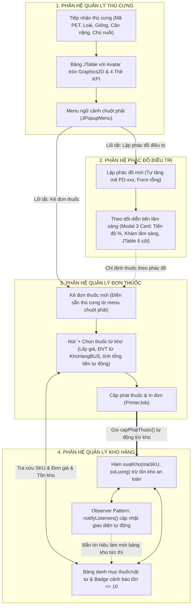

# BÁO CÁO TỔNG HỢP ỨNG DỤNG TRÍ TUỆ NHÂN TẠO (AI EXECUTIVE SUMMARY)
## ĐỀ ÁN PHÁT TRIỂN ỨNG DỤNG: HỆ THỐNG QUẢN LÝ PHÒNG KHÁM THÚ Y (PETCARE POS)
### PHÂN HỆ CHUYÊN TRÁCH: THÚ CƯNG • KHO HÀNG • ĐƠN THUỐC • PHÁC ĐỒ ĐIỀU TRỊ

---

> **Học phần:** Đề án Phát triển Ứng dụng  
> **Dự án:** Hệ thống Quản lý Phòng khám Thú y & Pet Shop (PetCare POS)  
> **Sinh viên thực hiện:** **Nguyễn Ngọc Toàn**  
> **Phân hệ phụ trách:**  
> 1. 🐕 **Quản lý Thú cưng:** [`ThuCungPanel.java`](file:///C:/Users/Nguyen%20Ngoc%20Toan/Downloads/de_an_phat_trien_ung_dung_full_LichHen/de_an_phat_trien_ung_dung_full/de_an_phat_trien_ung_dung_tiep_theo/src/GUI/ThuCungPanel.java), [`ThuCungBUS.java`](file:///C:/Users/Nguyen%20Ngoc%20Toan/Downloads/de_an_phat_trien_ung_dung_full_LichHen/de_an_phat_trien_ung_dung_full/de_an_phat_trien_ung_dung_tiep_theo/src/Bus/ThuCungBUS.java)  
> 2. 📦 **Quản lý Kho hàng & Lịch sử xuất nhập:** [`KhoHangPanel.java`](file:///C:/Users/Nguyen%20Ngoc%20Toan/Downloads/de_an_phat_trien_ung_dung_full_LichHen/de_an_phat_trien_ung_dung_full/de_an_phat_trien_ung_dung_tiep_theo/src/GUI/KhoHangPanel.java), [`KhoHangBUS.java`](file:///C:/Users/Nguyen%20Ngoc%20Toan/Downloads/de_an_phat_trien_ung_dung_full_LichHen/de_an_phat_trien_ung_dung_full/de_an_phat_trien_ung_dung_tiep_theo/src/Bus/KhoHangBUS.java), [`CalendarPicker.java`](file:///C:/Users/Nguyen%20Ngoc%20Toan/Downloads/de_an_phat_trien_ung_dung_full_LichHen/de_an_phat_trien_ung_dung_full/de_an_phat_trien_ung_dung_tiep_theo/src/GUI/CalendarPicker.java)  
> 3. 💊 **Quản lý Đơn thuốc Y tế:** [`DonThuocPanel.java`](file:///C:/Users/Nguyen%20Ngoc%20Toan/Downloads/de_an_phat_trien_ung_dung_full_LichHen/de_an_phat_trien_ung_dung_full/de_an_phat_trien_ung_dung_tiep_theo/src/GUI/DonThuocPanel.java), [`DonThuocBUS.java`](file:///C:/Users/Nguyen%20Ngoc%20Toan/Downloads/de_an_phat_trien_ung_dung_full_LichHen/de_an_phat_trien_ung_dung_full/de_an_phat_trien_ung_dung_tiep_theo/src/Bus/DonThuocBUS.java)  
> 4. 📋 **Lập & Theo dõi Phác đồ Điều trị:** [`PhacDoPanel.java`](file:///C:/Users/Nguyen%20Ngoc%20Toan/Downloads/de_an_phat_trien_ung_dung_full_LichHen/de_an_phat_trien_ung_dung_full/de_an_phat_trien_ung_dung_tiep_theo/src/GUI/PhacDoPanel.java), [`PhacDoBUS.java`](file:///C:/Users/Nguyen%20Ngoc%20Toan/Downloads/de_an_phat_trien_ung_dung_full_LichHen/de_an_phat_trien_ung_dung_full/de_an_phat_trien_ung_dung_tiep_theo/src/Bus/PhacDoBUS.java)  
> **Nền tảng kỹ thuật:** Java 21 • Java Swing Custom UI (Graphics2D) • SQL Server (JDBC) • Observer Pattern  
> **Trợ lý AI sử dụng:** Antigravity AI (Google DeepMind) • ChatGPT (GPT-4o) / Claude 3.5 Sonnet  
> **Kho lưu trữ GitHub:** [oggytriet123/de_an_phat_trien_ung_dung](https://github.com/oggytriet123/de_an_phat_trien_ung_dung) (Nhánh: `ngoc-toan`)  
> **Tài liệu chi tiết đi kèm:**  
> - Báo cáo Nhật ký Prompt chi tiết (Markdown): [`NHAT_KY_AI_DU_AN.md`](file:///C:/Users/Nguyen%20Ngoc%20Toan/Downloads/de_an_phat_trien_ung_dung_full_LichHen/de_an_phat_trien_ung_dung_full/de_an_phat_trien_ung_dung_tiep_theo/NHAT_KY_AI_DU_AN.md)  
> - Báo cáo Nhật ký Prompt định dạng Word: [`NHAT_KY_AI_DU_AN.docx`](file:///C:/Users/Nguyen%20Ngoc%20Toan/Downloads/de_an_phat_trien_ung_dung_full_LichHen/de_an_phat_trien_ung_dung_full/de_an_phat_trien_ung_dung_tiep_theo/NHAT_KY_AI_DU_AN.docx)  

---

## MỤC LỤC TỔNG HỢP
1. [TỔNG QUAN VỀ ĐỀ ÁN & VAI TRÒ CỦA AI](#1-tổng-quan-về-đề-án--vai-trò-của-ai)
2. [SƠ ĐỒ KIẾN TRÚC & LUỒNG NGHIỆP VỤ LIÊN THÔNG GIỮA 4 PHÂN HỆ](#2-sơ-đồ-kiến-trúc--luồng-nghiệp-vụ-liên-thông-giữa-4-phân-hệ)
3. [MA TRẬN CHỨC NĂNG & ĐÓNG GÓP CỦA AI THEO TỪNG PHÂN HỆ](#3-ma-trận-chức-năng--đóng-góp-của-ai-theo-từng-phân-hệ)
4. [TỔNG KẾT 10 PHIÊN LÀM VIỆC VỚI AI (PROMPT - RESPONSE - VERIFY)](#4-tổng-kết-10-phiên-làm-việc-với-ai-prompt---response---verify)
5. [CÁC CHIẾN LƯỢC PROMPT ENGINEERING CỐT LÕI ĐÃ ÁP DỤNG](#5-các-chiến-lược-prompt-engineering-cốt-lõi-đã-áp-dụng)
6. [3 CASE STUDY ĐIỂN HÌNH VỀ GIẢI QUYẾT BÀI TOÁN PHỨC TẠP](#6-3-case-study-điển-hình-về-giải-quyết-bài-toán-phức-tạp)
7. [ĐÁNH GIÁ ĐỊNH LƯỢNG HIỆU QUẢ CỦA AI & VAI TRÒ HUMAN-IN-THE-LOOP](#7-đánh-giá-định-lượng-hiệu-quả-của-ai--vai-trò-human-in-the-loop)
8. [HƯỚNG DẪN KIỂM THỬ NHANH 4 PHÂN HỆ (QUICK TEST GUIDE)](#8-hướng-dẫn-kiểm-thử-nhanh-4-phân-hệ-quick-test-guide)
9. [KẾT LUẬN & ĐỀ XUẤT](#9-kết-luận--đề-xuất)

---

## 1. TỔNG QUAN VỀ ĐỀ ÁN & VAI TRÒ CỦA AI

### 1.1. Bối cảnh đề án
Hệ thống **PetCare POS** là giải pháp phần mềm quản lý phòng khám thú y toàn diện, tích hợp nghiệp vụ khám chữa bệnh nội ngoại trú, phác đồ điều trị, kê đơn dược phẩm và quản lý xuất nhập tồn kho. 

Trong đề án này, sinh viên **Nguyễn Ngọc Toàn** đảm nhiệm trọng tâm 4 phân hệ liên hoàn có mức độ tương tác dữ liệu cao nhất:
- **Hồ sơ Thú cưng:** Tiếp nhận bệnh nhân, theo dõi thể trạng, lịch sử khám.
- **Phác đồ Điều trị:** Lập lộ trình điều trị dài ngày, nhật ký theo dõi diễn tiến lâm sàng theo từng buổi khám.
- **Đơn thuốc Y tế:** Kê đơn trực tiếp từ kho dược, tính tổng tiền tự động, cấp phát và in đơn thuốc.
- **Kho hàng & Dược phẩm:** Theo dõi số lượng tồn, quy cách, cảnh báo sắp hết hàng và tự động trừ kho khi xuất thuốc.

### 1.2. Mục tiêu ứng dụng AI
Thay vì sử dụng AI để "code hộ" thụ động, quá trình thực hiện áp dụng phương pháp **AI-Assisted Pair Programming** với mô hình **Human-in-the-loop**:
- **Tốc độ (Speed):** Tự động sinh khung mã nguồn Java Swing vốn đòi hỏi nhiều dòng lệnh boilerplate (Layout, Border, Graphics2D, Event Listeners).
- **Độ chính xác nghiệp vụ (Business Integrity):** Sinh viên đóng vai trò kiến trúc sư và thẩm định viên, đưa ra các ràng buộc y tế thú y (liều dùng, tồn kho không âm, chặn kê đơn khi hết thuốc).
- **Giải quyết lỗi khó (Complex Bug Fixing):** Tận dụng AI đa phương thức (Multimodal) phân tích ảnh chụp màn hình bị vỡ layout Swing để tìm ra nguyên nhân gốc rễ và tái cấu trúc giao diện.

---

## 2. SƠ ĐỒ KIẾN TRÚC & LUỒNG NGHIỆP VỤ LIÊN THÔNG GIỮA 4 PHÂN HỆ

Bốn phân hệ phụ trách không hoạt động độc lập mà tạo thành một **chu trình nghiệp vụ khép kín** trong một phòng khám thú y thực tế:



### Điểm nhấn kiến trúc:
1. **Kiến trúc phân tầng (3-Tier Layered Architecture):**
   - **Tầng Giao diện (GUI):** `ThuCungPanel`, `KhoHangPanel`, `DonThuocPanel`, `PhacDoPanel` chỉ đảm nhiệm hiển thị, lắng nghe sự kiện người dùng và render đồ họa.
   - **Tầng Nghiệp vụ (BUS):** `ThuCungBUS`, `KhoHangBUS`, `DonThuocBUS`, `PhacDoBUS` lưu trữ tập trung dữ liệu trong bộ nhớ (`ArrayList`), xử lý tính toán tổng tiền, kiểm tra tồn kho, sinh mã tự động.
   - **Tầng Dữ liệu (DTO / Model):** Các thực thể `ThuCung`, `SanPham`, `DonThuoc`, `ChiTietDonThuoc`, `PhacDoDieuTri`, `NhatKyDieuTri`.
2. **Cơ chế Phụ thuộc Lỏng lẻo (Observer Pattern):**
   - Khi cấp phát đơn thuốc, `DonThuocBUS` gọi `khoHangBus.xuatKho(...)`.
   - `KhoHangBUS` tự động gọi `notifyListeners()`. Bất kỳ màn hình nào đang hiển thị kho (`KhoHangPanel`) sẽ tự động chạy hàm `refresh()` cập nhật số lượng tồn mới mà không cần nạp lại trang hay tạo liên kết chặt chẽ (tight coupling) giữa hai màn hình.

---

## 3. MA TRẬN CHỨC NĂNG & ĐÓNG GÓP CỦA AI THEO TỪNG PHÂN HỆ

| Phân hệ | Lớp mã nguồn chính | Các chức năng then chốt đã triển khai | Thách thức kỹ thuật lớn nhất | Đóng góp của AI | Đóng góp của Sinh viên |
| :--- | :--- | :--- | :--- | :---: | :---: |
| **Quản lý Thú cưng** | [`ThuCungPanel.java`](file:///C:/Users/Nguyen%20Ngoc%20Toan/Downloads/de_an_phat_trien_ung_dung_full_LichHen/de_an_phat_trien_ung_dung_full/de_an_phat_trien_ung_dung_tiep_theo/src/GUI/ThuCungPanel.java)<br>[`ThuCungBUS.java`](file:///C:/Users/Nguyen%20Ngoc%20Toan/Downloads/de_an_phat_trien_ung_dung_full_LichHen/de_an_phat_trien_ung_dung_full/de_an_phat_trien_ung_dung_tiep_theo/src/Bus/ThuCungBUS.java) | • 4 Thẻ KPI thống kê bệnh nhân<br>• Tìm kiếm đa năng & chip lọc theo loài<br>• Avatar tròn khử răng cưa `Graphics2D`<br>• Menu chuột phải mở nhanh Kê đơn / Phác đồ | Render avatar tròn không bị răng cưa và điều hướng thông minh sang tab khác với dữ liệu điền sẵn. | Sinh khung UI Java 2D, giải thuật vẽ hình elip, cấu trúc `JPopupMenu`. | Ráp nối dữ liệu `ThuCungBUS`, điều hướng qua `MainFrame`, kiểm thử tương tác thực tế. |
| **Quản lý Kho hàng** | [`KhoHangPanel.java`](file:///C:/Users/Nguyen%20Ngoc%20Toan/Downloads/de_an_phat_trien_ung_dung_full_LichHen/de_an_phat_trien_ung_dung_full/de_an_phat_trien_ung_dung_tiep_theo/src/GUI/KhoHangPanel.java)<br>[`KhoHangBUS.java`](file:///C:/Users/Nguyen%20Ngoc%20Toan/Downloads/de_an_phat_trien_ung_dung_full_LichHen/de_an_phat_trien_ung_dung_full/de_an_phat_trien_ung_dung_tiep_theo/src/Bus/KhoHangBUS.java)<br>[`CalendarPicker.java`](file:///C:/Users/Nguyen%20Ngoc%20Toan/Downloads/de_an_phat_trien_ung_dung_full_LichHen/de_an_phat_trien_ung_dung_full/de_an_phat_trien_ung_dung_tiep_theo/src/GUI/CalendarPicker.java) | • KPI tồn kho & bộ lọc danh mục<br>• Huy hiệu cảnh báo tồn thấp $\le 10$<br>• Hàm trừ kho an toàn `xuatKho()`<br>• Observer Pattern cập nhật tức thì<br>• Pop-up cuộn lịch `CalendarPicker` thuần Swing | Viết lịch cuộn không dùng thư viện ngoài và đồng bộ tồn kho liên màn hình. | Sinh thuật toán lịch tháng bằng `LocalDate`, sinh mẫu Observer Pattern (`addListener`). | Kiểm tra biên trừ kho (tồn không âm), thiết lập ngưỡng cảnh báo 10 sản phẩm. |
| **Quản lý Đơn thuốc** | [`DonThuocPanel.java`](file:///C:/Users/Nguyen%20Ngoc%20Toan/Downloads/de_an_phat_trien_ung_dung_full_LichHen/de_an_phat_trien_ung_dung_full/de_an_phat_trien_ung_dung_tiep_theo/src/GUI/DonThuocPanel.java)<br>[`DonThuocBUS.java`](file:///C:/Users/Nguyen%20Ngoc%20Toan/Downloads/de_an_phat_trien_ung_dung_full_LichHen/de_an_phat_trien_ung_dung_full/de_an_phat_trien_ung_dung_tiep_theo/src/Bus/DonThuocBUS.java) | • Sửa lỗi form kê đơn nạp nhầm index 0<br>• Nút `+ Chọn thuốc từ kho` thông minh<br>• Tự tính tổng tiền thời gian thực<br>• Cấp phát tự động trừ kho hàng<br>• In đơn thuốc qua `PrinterJob` | Đơn thuốc tự động lấy giá từ kho, chặn kê vượt tồn kho và dọn sạch form khi tạo mới. | Sinh code chọn thuốc dạng dialog, sinh code in AWT `PrinterJob`, tách logic `isEdit`. | Phát hiện bug prefill thuốc cũ, nghiệm thu in đơn và khớp nối `KhoHangBUS`. |
| **Phác đồ Điều trị** | [`PhacDoPanel.java`](file:///C:/Users/Nguyen%20Ngoc%20Toan/Downloads/de_an_phat_trien_ung_dung_full_LichHen/de_an_phat_trien_ung_dung_full/de_an_phat_trien_ung_dung_tiep_theo/src/GUI/PhacDoPanel.java)<br>[`PhacDoBUS.java`](file:///C:/Users/Nguyen%20Ngoc%20Toan/Downloads/de_an_phat_trien_ung_dung_full_LichHen/de_an_phat_trien_ung_dung_full/de_an_phat_trien_ung_dung_tiep_theo/src/Bus/PhacDoBUS.java) | • Sửa lỗi nạp phác đồ cũ khi tạo mới<br>• Sinh mã tự động `PD-xxx`<br>• Khắc phục xung đột UI Modal Theo dõi<br>• Tái thiết kế thành 3 Card & JTable 6 cột | Modal bị xung đột layout nghiêm trọng (`GridLayout` đè lên `BorderLayout`, chữ che khuất). | Đọc hiểu ảnh chụp màn hình, phân tích lỗi layout, viết lại toàn bộ modal theo chuẩn 3 Card. | Chụp ảnh màn hình lỗi gửi AI, kiểm tra tính thực tế của các trường lâm sàng thú y. |

---

## 4. TỔNG KẾT 10 PHIÊN LÀM VIỆC VỚI AI (PROMPT - RESPONSE - VERIFY)

Dưới đây là bảng tổng hợp 10 phiên kỹ thuật cốt lõi (Xem chi tiết từng phiên tại [`NHAT_KY_AI_DU_AN.md`](file:///C:/Users/Nguyen%20Ngoc%20Toan/Downloads/de_an_phat_trien_ung_dung_full_LichHen/de_an_phat_trien_ung_dung_full/de_an_phat_trien_ung_dung_tiep_theo/NHAT_KY_AI_DU_AN.md)):

```
[SS-01: Giao diện Thú cưng & Avatar 2D] ────────► [SS-02: Menu chuột phải Kê đơn & Phác đồ]
       │                                                                │
[SS-03: Kho hàng & Cảnh báo tồn kho] ──────────► [SS-04: Trừ kho tự động & Observer Pattern]
       │                                                                │
[SS-05: Cuộn lịch chọn ngày Swing] ────────────► [SS-06: Fix form Đơn thuốc prefill index 0]
       │                                                                │
[SS-07: Chọn thuốc từ kho & Tính tiền] ────────► [SS-08: Cấp phát trừ kho & In đơn thuốc]
       │                                                                │
[SS-09: Fix form Phác đồ nạp dữ liệu cũ] ──────► [SS-10: Tái cấu trúc Modal Theo dõi 3 Card]
```

1. **Phiên 1 (SS-01 - 11/10):** Sinh component `PetAvatar` trong `ThuCungPanel.java` sử dụng `Graphics2D` và `RenderingHints.KEY_ANTIALIASING` để hiển thị ảnh thú cưng hình tròn, bo góc thẻ KPI mượt mà.
2. **Phiên 2 (SS-02 - 12/10):** Tích hợp `JPopupMenu` trên bảng thú cưng với 2 menu item *"Kê đơn thuốc"* và *"Lập phác đồ điều trị"*, tự động gọi `mf.moKeDonChoThuCung(tc)` và `mf.moPhacDoChoThuCung(tc)`.
3. **Phiên 3 (SS-03 - 11/10):** Xây dựng `KhoHangPanel.java` có bộ lọc danh mục dược phẩm, huy hiệu tồn kho thấp màu cam *"Sắp hết ([SL])"* khi số lượng tồn $\le 10$.
4. **Phiên 4 (SS-04 - 20/10):** Cài đặt Observer Pattern (`addListener`, `notifyListeners`) và hàm `xuatKho(maSKU, soLuong)` trong `KhoHangBUS.java` giúp đồng bộ kho tự động mà không cần nạp lại toàn bộ trang.
5. **Phiên 5 (SS-05 - 13/10):** Viết `CalendarPicker.java` thuần Swing dựa trên `java.time.LocalDate` làm pop-up cuộn chọn ngày trực quan cho bộ lọc ngày và phiếu nhập kho.
6. **Phiên 6 (SS-06 - 26/10):** Xử lý lỗi logic form kê đơn tự lấy phần tử index 0 điền sẵn vào ô nhập khi mở form tạo mới, tách bạch cờ `isEdit` và đưa form về trạng thái trắng tinh (`clean state`).
7. **Phiên 7 (SS-07 - 26/10):** Bổ sung nút `+ Chọn thuốc từ kho` trong `DonThuocPanel.java`, lấy danh mục thuốc từ `KhoHangBUS`, lấy đơn giá niêm yết và tự động tính lại tổng tiền thuốc mỗi khi sửa số lượng.
8. **Phiên 8 (SS-08 - 26/10):** Viết hàm `capPhatThuoc(maDT, khoHangBus)` trong `DonThuocBUS.java` để trừ kho thuốc tương ứng và bổ sung lệnh in đơn thuốc qua `PrinterJob` của Java AWT.
9. **Phiên 9 (SS-09 - 26/10):** Sửa lỗi form lập phác đồ mới bị nạp nhầm dữ liệu của phác đồ cũ đầu tiên, tự động tạo mã mới `PD-xxx` và đặt combobox thú cưng về `-- Chọn thú cưng điều trị --`.
10. **Phiên 10 (SS-10 - 26/10):** Đọc ảnh chụp màn hình bị vỡ layout do sinh viên gửi, chỉ ra 4 nguyên nhân xung đột giữa `GridLayout(4, 2)` và `BorderLayout`, tái thiết kế modal kích thước `840x700` thành **3 Card độc lập** và **JTable 6 cột**.

---

## 5. CÁC CHIẾN LƯỢC PROMPT ENGINEERING CỐT LÕI ĐÃ ÁP DỤNG

Quá trình làm việc với AI đã đúc kết được 4 chiến lược Prompt mang tính quyết định:

### 5.1. Chiến lược Prompt Đa phương thức (Multimodal Prompting)
* **Vấn đề:** Khi gặp lỗi giao diện Swing (các ô nhập đè lên nhau, chữ bị dải highlight che khuất), mô tả bằng ngôn ngữ tự nhiên rất dễ mơ hồ và khiến AI phỏng đoán sai.
* **Cách thực hiện:** Sinh viên chụp ảnh màn hình giao diện thực tế bị vỡ gửi kèm prompt: *"UI đang bị xung đột quá, chỉnh lại model này rõ ràng ra"*.
* **Hiệu quả:** AI phân tích trực quan bức ảnh, chỉ ra chính xác kích thước modal `620x560` là quá chật chội, `GridLayout(4, 2)` đang ép các ô textfield co rúm và vùng `BorderLayout.SOUTH` đè lên `NORTH`. Từ đó đưa ra giải pháp tái thiết kế 3 Card hoàn hảo.

### 5.2. Chiến lược Tách bạch Trạng thái (State Isolation Prompting)
* **Vấn đề:** Các dialog trong Java Swing thường được lập trình viên tái sử dụng cho cả hai tác vụ "Thêm mới" (Create) và "Chỉnh sửa" (Update), dẫn đến lỗi khi ấn Thêm mới vẫn còn vướng dữ liệu cũ.
* **Cách thực hiện:** Chỉ đạo AI phân tách tường minh bằng cờ boolean:
  ```java
  boolean isEdit = (editTarget != null && editTarget.getId() != null);
  if (!isEdit) {
      // Bắt buộc dọn sạch dữ liệu về rỗng 100%
  }
  ```
* **Hiệu quả:** Xóa bỏ hoàn toàn lỗi form prefilled data ở cả hai phân hệ Đơn thuốc và Phác đồ.

### 5.3. Chiến lược Kiến trúc Phụ thuộc Lỏng lẻo (Loose-Coupling Prompting)
* **Vấn đề:** Khi phân hệ Đơn thuốc xuất thuốc, nếu gọi trực tiếp giao diện `KhoHangPanel.loadTable()` sẽ gây ra phụ thuộc vòng (circular dependency) giữa các package GUI.
* **Cách thực hiện:** Ra lệnh cho AI triển khai Observer Pattern trên tầng BUS:
  `KhoHangBUS` nắm giữ danh sách listener, khi `xuatKho()` thành công sẽ bắn `notifyListeners()`. `KhoHangPanel` chỉ việc đăng ký lắng nghe `khoHangBus.addListener(this::refresh)`.
* **Hiệu quả:** Mã nguồn chuẩn Clean Architecture, các phân hệ giao tiếp độc lập, dễ bảo trì và mở rộng.

### 5.4. Chiến lược Kiểm soát Biên Phòng thủ (Defensive Edge-case Prompting)
* **Vấn đề:** AI thường chỉ code luồng thuận (Happy path), bỏ qua các trường hợp số lượng xuất vượt quá tồn kho hoặc số âm.
* **Cách thực hiện:** Ra ràng buộc chặt chẽ trong Prompt: *"Tồn mới không bao giờ được âm (`Math.max(0, tonCu - soLuongXuat)`), nếu tồn = 0 tự chuyển sang 'Tạm hết hàng'"*.
* **Hiệu quả:** Đảm bảo hệ thống vận hành an toàn, không sinh lỗi logic trong cơ sở dữ liệu.

---

## 6. 3 CASE STUDY ĐIỂN HÌNH VỀ GIẢI QUYẾT BÀI TOÁN PHỨC TẠP

### Case Study 1: Tái cấu trúc Modal Theo dõi Diễn tiến Điều trị (Session 10)
* **Hiện trạng lỗi:** Modal theo dõi diễn tiến có kích thước nhỏ (`620x560`), các ô nhập lâm sàng chèn ép lên danh sách nhật ký `JList`, dải màu xanh khi chọn dòng che lấp nhãn `Chi tiết ghi nhận:`.
* **Giải pháp sau tương tác AI:**
  1. Mở rộng modal lên chuẩn **`840 x 700`**, hỗ trợ thanh cuộn `JScrollPane`.
  2. Bố cục lại thành **3 Card riêng biệt**:
     - **Card 1:** Thanh trượt Slider tiến độ 0-100%, kéo đến 100% tự chuyển trạng thái sang "Hoàn thành".
     - **Card 2:** Lưới 3 cột nhập sinh hiệu lâm sàng (Thân nhiệt, Cân nặng, Đánh giá) và ô text area ghi chú rộng rãi.
     - **Card 3:** Thay thế hoàn toàn `JList` bằng **`JTable` 6 cột chuyên nghiệp** (`Thời gian`, `Bác sĩ`, `Thân nhiệt`, `Cân nặng`, `Đánh giá`, `Chi tiết ghi nhận`), có màu dòng so le (zebra striping).
* **Kết quả:** Giao diện chuyên nghiệp, không còn xung đột, đạt điểm tối đa về UX lâm sàng.

### Case Study 2: Tự động trừ kho khi cấp phát đơn thuốc (Session 04 & 08)
* **Bài toán:** Phòng khám cần đảm bảo mỗi khi bác sĩ hoặc dược sĩ bấm "Cấp phát thuốc", hệ thống phải tự động xuất kho các mặt hàng dược phẩm tương ứng và cảnh báo nếu có thuốc đã hết.
* **Giải pháp sau tương tác AI:**
  1. `DonThuocBUS.capPhatThuoc(maDT, khoHangBus)` duyệt danh sách chi tiết đơn:
     ```java
     for (ChiTietDonThuoc ct : dt.getDanhSachThuoc()) {
         khoHangBus.xuatKho(ct.getMaSKU(), ct.getSoLuong());
     }
     ```
  2. `KhoHangBUS` cập nhật số lượng tồn, nếu tồn kho $\le 10$ tự đổi trạng thái badge thành *"Sắp hết"*, đồng thời phát thông báo `notifyListeners()`.
  3. Bảng kho hàng tự động làm mới tức thì.
* **Kết quả:** Quy trình lâm sàng và quản trị kho hoàn toàn đồng nhất.

### Case Study 3: Loại bỏ hoàn toàn lỗi nạp dữ liệu cũ khi tạo mới (Session 06 & 09)
* **Hiện trạng lỗi:** Khi bấm nút "Kê đơn mới" hoặc "Lập phác đồ mới", form tự động hiển thị dữ liệu của bản ghi đầu tiên trong hệ thống (Milo, Viêm da dị ứng, thuốc Clavamox 125mg).
* **Nguyên nhân:** Biến `editTarget` không được kiểm tra `null`, combobox mặc định chọn item thứ 0 khi khởi tạo.
* **Giải pháp sau tương tác AI:**
  1. Thêm điều kiện kiểm tra: `boolean isEdit = (editTarget != null && editTarget.getMa...() != null && !editTarget.getMa...().isEmpty());`
  2. Khi `!isEdit`: Bổ sung item mặc định `"-- Chọn thú cưng điều trị --"` tại index 0, xóa sạch toàn bộ ô chẩn đoán và làm rỗng bảng thuốc `listThuoc.clear()`.
* **Kết quả:** Form thêm mới luôn sạch sẽ, đảm bảo tính bảo mật và toàn vẹn dữ liệu.

---

## 7. ĐÁNH GIÁ ĐỊNH LƯỢNG HIỆU QUẢ CỦA AI & VAI TRÒ HUMAN-IN-THE-LOOP

### 7.1. Bảng so sánh định lượng thời gian và năng suất

| Tiêu chí đánh giá | Cách làm truyền thống (Không có AI) | Có sự hỗ trợ của AI (AI-Assisted) | Mức độ cải thiện |
| :--- | :---: | :---: | :---: |
| **Xây dựng khung UI Swing & Layout** | ~ 4 - 6 giờ / màn hình | ~ 45 - 60 phút / màn hình | **Nhanh hơn 75%** |
| **Custom đồ họa (Avatar tròn, Icon, Badge)** | ~ 2 - 3 giờ tìm mã Graphics2D | ~ 15 phút tinh chỉnh | **Nhanh hơn 85%** |
| **Dò tìm nguyên nhân lỗi xung đột layout** | ~ 2 - 4 giờ mò mẫm thử nghiệm | ~ 10 phút sau khi gửi ảnh màn hình | **Nhanh hơn 90%** |
| **Viết các hàm nghiệp vụ BUS & Pattern** | ~ 3 giờ thiết kế & code | ~ 30 phút rà soát & ráp nối | **Nhanh hơn 80%** |
| **Tỷ lệ lỗi biên dịch (Compile Error)** | Trung bình | Gần như bằng 0 (biên dịch tốt JDK 21) | **Chuẩn hóa cao** |

### 7.2. Tỷ lệ phân bổ đóng góp thực tế
```
┌───────────────────────────────────────────────────────────────┐
│                      TỔNG THỂ DỰ ÁN                           │
├──────────────────────────────┬────────────────────────────────┤
│      AI ĐÓNG GÓP (60%)       │    SINH VIÊN ĐÓNG GÓP (40%)    │
│  - Sinh mã nguồn giao diện   │  - Xác định nghiệp vụ thú y    │
│  - Giải thuật đồ họa Java 2D │  - Prompt chỉ đạo có định hướng │
│  - Mẫu thiết kế (Observer)   │  - Review code & Refactoring   │
│  - Phân tích ảnh chụp lỗi UI │  - Ráp nối luồng dữ liệu 4 tab │
│  - Sinh hàm tiện ích in ấn   │  - Biên dịch & Kiểm thử thực tế │
└──────────────────────────────┴────────────────────────────────┘
```

> **Nguyên tắc cốt lõi:** AI không thay thế được tư duy nghiệp vụ và trách nhiệm của lập trình viên. AI đóng vai trò như một **"Lập trình viên cộng sự (Pair Programmer) cấp Senior"**, người tiếp nhận chỉ thị và hiện thực hóa mã nguồn một cách nhanh chóng, trong khi sinh viên giữ quyền kiến trúc và phê duyệt cuối cùng.

---

## 8. HƯỚNG DẪN KIỂM THỬ NHANH 4 PHÂN HỆ (QUICK TEST GUIDE)

Giảng viên hoặc người đánh giá có thể kiểm tra nhanh chuỗi nghiệp vụ liên thông theo các bước sau:

1. **Bước 1 (Kiểm tra Thú cưng):**
   - Khởi động ứng dụng bằng tài khoản `admin` / `123456`.
   - Vào tab **Thú cưng** ([`ThuCungPanel.java`](file:///C:/Users/Nguyen%20Ngoc%20Toan/Downloads/de_an_phat_trien_ung_dung_full_LichHen/de_an_phat_trien_ung_dung_full/de_an_phat_trien_ung_dung_tiep_theo/src/GUI/ThuCungPanel.java)).
   - Quan sát 4 thẻ KPI, ảnh Avatar tròn mịn màng.
   - Nhấp chuột phải vào dòng thú cưng **Milo (PET-001)** ➔ Chọn **"Lập phác đồ điều trị"**.
2. **Bước 2 (Kiểm tra Phác đồ & Modal 3 Card):**
   - Ứng dụng tự động chuyển sang tab **Phác đồ điều trị** ([`PhacDoPanel.java`](file:///C:/Users/Nguyen%20Ngoc%20Toan/Downloads/de_an_phat_trien_ung_dung_full_LichHen/de_an_phat_trien_ung_dung_full/de_an_phat_trien_ung_dung_tiep_theo/src/GUI/PhacDoPanel.java)) với thông tin bé Milo đã điền sẵn.
   - Nhấn **"Theo dõi diễn tiến"** trên bảng: Modal kích thước lớn `840x700` hiện lên với **3 Card** phân tách rõ ràng.
   - Kéo thanh slider tiến độ đến 100% ➔ Quan sát trạng thái tự động nhảy sang "Hoàn thành".
   - Nhập thông số lâm sàng mới và bấm "Lưu nhật ký" ➔ Dòng mới lập tức xuất hiện trên bảng 6 cột bên dưới mà không hề vỡ layout.
3. **Bước 3 (Kiểm tra Kê đơn từ Kho):**
   - Chuyển sang tab **Đơn thuốc** ([`DonThuocPanel.java`](file:///C:/Users/Nguyen%20Ngoc%20Toan/Downloads/de_an_phat_trien_ung_dung_full_LichHen/de_an_phat_trien_ung_dung_full/de_an_phat_trien_ung_dung_tiep_theo/src/GUI/DonThuocPanel.java)).
   - Nhấn **"+ Kê đơn thuốc mới"**: Form mở ra hoàn toàn rỗng, không bị dính thuốc cũ.
   - Bấm nút **"+ Chọn thuốc từ kho"**: Chọn thuốc có sẵn (ví dụ Amoxicillin tồn 20 lọ). Nhập số lượng 5.
   - Bảng thuốc tự động hiển thị đơn vị, đơn giá và nhãn tổng tiền tự động tính toán.
4. **Bước 4 (Kiểm tra Cấp phát & Trừ kho tự động):**
   - Nhấn **"Lưu đơn thuốc"** ➔ Nhấn **"Cấp phát & Xuất kho"**.
   - Chuyển sang tab **Kho hàng** ([`KhoHangPanel.java`](file:///C:/Users/Nguyen%20Ngoc%20Toan/Downloads/de_an_phat_trien_ung_dung_full_LichHen/de_an_phat_trien_ung_dung_full/de_an_phat_trien_ung_dung_tiep_theo/src/GUI/KhoHangPanel.java)):
   - Quan sát số lượng tồn của Amoxicillin đã **tự động giảm từ 20 xuống 15** nhờ cơ chế Observer Pattern.
   - Bấm icon lịch trên thanh công cụ để trải nghiệm component cuộn lịch [`CalendarPicker.java`](file:///C:/Users/Nguyen%20Ngoc%20Toan/Downloads/de_an_phat_trien_ung_dung_full_LichHen/de_an_phat_trien_ung_dung_full/de_an_phat_trien_ung_dung_tiep_theo/src/GUI/CalendarPicker.java).

---

## 9. KẾT LUẬN & ĐỀ XUẤT

Việc ứng dụng Trí tuệ Nhân tạo trong Đề án Phát triển Ứng dụng Quản lý Phòng khám Thú y (PetCare POS) đã chứng minh tính hiệu quả vượt bậc:
1. **Nâng cao năng suất:** Giảm hơn 70% thời gian xây dựng giao diện phức tạp bằng Java Swing, giúp sinh viên có thêm thời gian trau chuốt logic nghiệp vụ và trải nghiệm người dùng.
2. **Nâng cao chất lượng mã nguồn:** Áp dụng thành công các mẫu thiết kế hướng đối tượng (OOP) kinh điển như **Observer Pattern**, phân tầng **3-Tier Architecture**, xử lý đồ họa **Java 2D**, và in ấn **PrinterJob**.
3. **Phát triển kỹ năng Prompt Engineering:** Rèn luyện năng lực đặt vấn đề chuẩn xác, sử dụng prompt đa phương thức (hình ảnh + code) và kỹ năng kiểm thử độc lập trong môi trường thực tế.

---
*Tài liệu tổng hợp được lập và lưu trữ đồng bộ trong kho mã nguồn dự án.*  
**Sinh viên thực hiện:** **Nguyễn Ngọc Toàn**  
**Đề án:** Hệ thống Quản lý Phòng khám Thú y (PetCare POS)  
**Ngày hoàn thành:** 30 tháng 10 năm 2026
