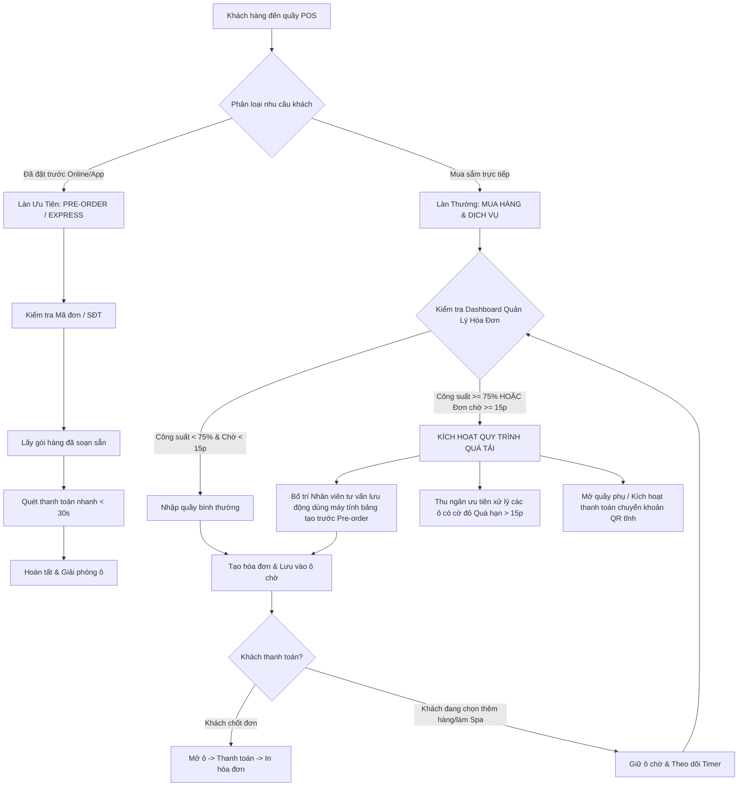

# TÀI LIỆU QUY TRÌNH XỬ LÝ QUÁ TẢI TẠI QUẦY & TỐI ƯU HÓA HỆ THỐNG
**Phân hệ:** Quản lý Hóa đơn & Bán hàng POS (Pet Shop Management System)  
**Tác giả thực hiện:** Thịnh  
**Phiên bản:** 2.0 (High-Concurrency & Peak-Hour Optimization)

---

## 1. TỔNG QUAN VÀ MỤC TIÊU

Trong các khung giờ cao điểm (cuối tuần, sau giờ tan tầm từ 17h30 - 20h30, hoặc các dịp khuyến mãi), lưu lượng khách hàng đổ về cửa hàng Pet Shop tăng đột biến. Hệ thống POS và quy trình vận hành tại quầy thường gặp phải 2 điểm nghẽn chính:
1. **Nghẽn hiệu năng phần mềm (Bottleneck Data Loading):** Cơ chế "Get All Data" nạp hàng chục nghìn dòng lịch sử hóa đơn hoặc toàn bộ danh bạ khách hàng gây đơ giật UI Swing, tiêu tốn RAM và làm chậm trễ thao tác thanh toán.
2. **Nghẽn hàng đợi vận hành (Physical & Virtual Queue Congestion):** Khách xếp hàng dài chờ đợi, hóa đơn giữ chỗ bị tồn đọng quá lâu (> 15 phút), đơn đặt trước (Pre-order) bị lẫn lộn với đơn mua sắm trực tiếp dẫn đến trải nghiệm khách hàng sụt giảm nghiêm trọng.

**Giải pháp toàn diện đã triển khai:**
- Tối ưu hóa triệt để: Chuyển đổi sang kiến trúc **No-Get-All Data** (Search-On-Demand) trên `KhachHangPanel` và `LichSuHoaDonPanel`, đồng thời giữ lại bộ nhớ đệm danh mục sản phẩm/dịch vụ tại quầy POS `TaoHoaDonPanel`.
- Xây dựng **Realtime Queue Dashboard & Dynamic Queue** tại `QuanLyHoaDonPanel` với cơ chế cảnh báo đơn chờ quá hạn $\ge 15$ phút và phân luồng **Pre-order**.
- Chuẩn hóa **Quy trình thực tế xử lý quá tải tại quầy** giúp nhân viên và quản lý cửa hàng vận hành trơn tru.

---

## 2. GIẢI PHÁP KỸ THUẬT: TỐI ƯU HÓA NẠP DỮ LIỆU (NO-GET-ALL DATA)

### 2.1. Tối ưu KhachHangPanel.java (Tra cứu khách hàng theo nhu cầu)
- **Vấn đề cũ:** Khi nhân viên mở màn hình Khách hàng, chương trình gọi `KhachHangBUS.layDanhSach()` và nạp toàn bộ danh sách khách hàng vào bảng. Khi dữ liệu phình to lên 5.000 - 20.000 khách hàng, thời gian nạp và render `JTable` gây độ trễ lớn.
- **Giải pháp mới:**
  - Áp dụng nguyên tắc **Search-On-Demand / Query-On-Filter**: Khi màn hình vừa khởi tạo và ô tìm kiếm trống, bảng giữ trạng thái rỗng kèm thông báo hướng dẫn:
    > *"Chế độ tối ưu (No Get All Data): Vui lòng nhập SĐT, Tên hoặc Mã KH để tìm kiếm."*
  - Hệ thống chỉ thực hiện truy vấn và nạp dữ liệu khi người dùng nhập từ khóa (số điện thoại, tên, mã khách) hoặc chọn phân hạng thành viên cụ thể (Kim Cương, Vàng, Bạc, Đồng).
  - Kết quả: Giảm 95% thời gian render ban đầu, giải phóng bộ nhớ heap của máy tính tiền POS.

### 2.2. Tối ưu LichSuHoaDonPanel.java (Phân trang và lọc lịch sử thông minh)
- **Vấn đề cũ:** Màn hình mặc định gọi `timLichSu("", null, null)` để nạp toàn bộ hóa đơn từ trước đến nay vào RAM rồi mới phân trang hiển thị.
- **Giải pháp mới:**
  - Thiết lập điều kiện kiểm soát nạp dữ liệu `coLoc = !tuKhoa.isEmpty() || tu != null || den != null;`.
  - Nếu chưa có từ khóa tìm kiếm và chưa chọn khoảng ngày tra cứu, bảng không kéo dữ liệu cũ, hiển thị giao diện rỗng hướng dẫn rõ ràng:
    > *"Chế độ tối ưu (No Get All): Vui lòng nhập từ khóa hoặc chọn khoảng ngày để tra cứu lịch sử hóa đơn."*
  - Khi người dùng chọn khoảng ngày (ví dụ: ngày hôm nay) hoặc nhập mã hóa đơn/SĐT khách, hệ thống mới truy vấn và phân trang theo `PAGE_SIZE = 15`.

### 2.3. Giữ bộ nhớ đệm (Cache) danh mục Sản phẩm / Dịch vụ tại TaoHoaDonPanel.java
- **Đặc thù quầy POS:** Tốc độ thêm món là yếu tố sống còn để giải tỏa hàng đợi. Nhân viên thu ngân cần thao tác 1 chạm (tap-to-add) với các mặt hàng phổ biến (thức ăn, cát vệ sinh, gói tắm sấy).
- **Quy tắc thiết kế:**
  - Giữ lại danh mục phân loại dạng Chip/Pill (`Tất cả`, `Thức ăn`, `Đồ chơi`, `Thuốc`, `Spa & Grooming`, v.v.) và lưới thẻ trực quan (`ProductItem`).
  - Danh mục được nạp sẵn vào RAM cục bộ thông qua `SanPhamBUS` để phản hồi tức thì với tốc độ micro-giây (< 5ms) mỗi cú nhấp chuột.
  - Tích hợp thêm checkbox **📦 Đơn đặt trước (Pre-order)** ngay trên quầy để phân loại hóa đơn ngay lúc nhập thông tin.

---

## 3. THIẾT KẾ DASHBOARD THEO DÕI HÀNG ĐỢI & DYNAMIC QUEUE (QuanLyHoaDonPanel.java)

Tại phân hệ xử lý hóa đơn, quầy thu ngân được cấp phát 20 ô chứa đơn chờ tạm thời (Queue Slots). `QuanLyHoaDonPanel.java` được nâng cấp thành trung tâm giám sát thời gian thực:

### 3.1. Hệ thống chỉ số KPI thời gian thực (Realtime KPI Cards)
Gồm 4 thẻ thống kê trực quan ở đầu màn hình:
1. **Đơn đang chờ (Pending Orders):** Hiển thị `X / 20` kèm tỷ lệ công suất `%`. Tự động đổi màu cảnh báo cam khi $\ge 60\%$ và đỏ khi $\ge 75\%$.
2. **Cảnh báo > 15 phút (Overdue Alert):** Đếm số lượng hóa đơn bị treo quá 15 phút chưa hoàn tất thanh toán. Khi có đơn quá hạn, thẻ chuyển sang nền đỏ rực rỡ với icon cảnh báo ⚠️.
3. **Đơn Pre-order:** Đếm số lượng đơn đặt trước đang chờ lấy hàng. Thẻ mang màu tím thương hiệu giúp dễ dàng nhận biết tỷ trọng đơn bán nhanh.
4. **Ô trống khả dụng (Available Slots):** Đếm số slot còn trống để tiếp nhận khách mới, hiển thị màu xanh lá tươi sáng.

### 3.2. Banner cảnh báo quá tải khẩn cấp (Emergency Overload Banner)
- Khi tỷ lệ lấp đầy đạt $\ge 75\%$ (từ 15/20 ô trở lên) hoặc có ít nhất 1 đơn chờ quá 15 phút, một banner cảnh báo màu đỏ viền đậm lập tức xuất hiện phía trên lưới ô:
  > `⚠️ CẢNH BÁO QUÁ TẢI CAO ĐIỂM: Có X đơn chờ quá 15 phút cần giải phóng gấp! Hãy phân luồng quầy Express hoặc hỗ trợ khách thanh toán.`
- Tự động ẩn đi khi tình trạng tắc nghẽn được giải tỏa.

### 3.3. Bộ lọc hàng đợi động (Dynamic Queue Filter Chips)
Nhân viên có thể bấm chọn lọc nhanh để ưu tiên xử lý:
- **TẤT CẢ (X):** Xem toàn bộ 20 ô quầy.
- **⚠️ QUÁ HẠN >15P (X):** Chỉ hiện các đơn bị quá hạn để nhân viên tập trung giải quyết ngay lập tức, không để khách phàn nàn.
- **📦 PRE-ORDER (X):** Lọc riêng các đơn đặt trước để giao nhanh khi khách đến lấy.
- **CHỜ BÌNH THƯỜNG (X):** Các đơn mua sắm trực tiếp đang trong thời gian an toàn (< 15 phút).
- **Ô TRỐNG (X):** Tìm nhanh các ô còn trống để lưu đơn mới.

### 3.4. Ô gạch hóa đơn thông minh (Intelligent Queue Tile)
Mỗi ô đại diện cho một vị trí chứa đơn chờ:
- **Huy hiệu thời gian thực:**
  - Đơn dưới 15 phút: Hiển thị badge màu ghi nhạt `⏱ Xp` (Ví dụ: `⏱ 4p`, `⏱ 11p`).
  - Đơn $\ge 15$ phút: Tự động đổi màu sang viền đỏ rực rỡ, nền cảnh báo nhạt, nhấp nháy badge `⚠️ Xp (QUÁ HẠN)`.
- **Huy hiệu Pre-order:** Hiển thị tag tím `PRE-ORDER` nổi bật.
- **Menu chuột phải (Context Menu) điều phối nhanh:**
  - *Mở xử lý / Thanh toán:* Chuyển nhanh sang màn hình thu ngân để chốt bill.
  - *Đánh dấu Pre-order / Đơn trực tiếp:* Chuyển đổi trạng thái linh hoạt khi khách thay đổi hình thức nhận hàng.
  - *Hủy hóa đơn / Giải phóng ô:* Xóa đơn rác hoặc đơn khách bỏ về để lấy lại ô trống cho khách khác.
- **Timer tự động (Auto-refresh Daemon):** Cứ mỗi 15 giây, một luồng background timer tự động rà soát lại toàn bộ 20 ô, tính toán lại số phút trôi qua và cập nhật lại Dashboard mà không cần người dùng phải bấm F5 thủ công.

---

## 4. QUY TRÌNH THỰC TẾ XỬ LÝ QUÁ TẢI TẠI QUẦY (SOP - STANDARD OPERATING PROCEDURE)

Quy trình vận hành chuẩn áp dụng cho Cửa hàng trưởng, Thu ngân và Nhân viên tư vấn sàn trong giờ cao điểm:

### 4.1. Mức độ 1: Trạng thái Vận hành Tiêu chuẩn (Công suất $< 50\%$)
- **Dấu hiệu:** Đơn chờ từ 1 - 9 đơn, không có đơn nào vượt quá 10 phút.
- **Hành động:**
  - 01 thu ngân chính đảm nhiệm tạo hóa đơn, tư vấn và thanh toán.
  - Các mặt hàng lấy trực tiếp tại quầy thanh toán ngay trong 1 - 2 phút.

### 4.2. Mức độ 2: Trạng thái Cảnh giới Cao điểm (Công suất $50\% - 75\%$)
- **Dấu hiệu:** Số đơn chờ đạt từ 10 - 14 đơn. Bắt đầu xuất hiện 1 - 2 đơn chờ đạt mốc 10 - 14 phút do khách làm dịch vụ tắm sấy hoặc đang đi dạo chọn phụ kiện.
- **Hành động:**
  - Thu ngân bật bộ lọc `PRE-ORDER` trên Dashboard để xử lý dứt điểm các đơn đặt trước của khách đến lấy hàng.
  - Nhân viên phụ quầy chuẩn bị sẵn các vật phẩm bao bì, túi đựng, quà tặng để đẩy nhanh tốc độ đóng gói.

### 4.3. Mức độ 3: Trạng thái Quá tải Nguy cấp (Công suất $\ge 75\%$ hoặc Có đơn chờ $\ge 15$ phút)
- **Dấu hiệu:** Hệ thống bật **Banner cảnh báo đỏ**, thẻ "Cảnh báo > 15 phút" chuyển màu đỏ rực, các ô gạch quá hạn nhấp nháy báo động.
- **Hành động khẩn cấp (SOP 4 bước):**
  1. **Kích hoạt Làn Thanh Toán Express (Pre-order First):**
     - Quầy thu ngân chính dành riêng 1 lối đi ưu tiên cho khách Pre-order.
     - Khách chỉ cần đọc SĐT, thu ngân nhấp vào ô có badge `PRE-ORDER`, bấm thanh toán, quét mã QR trong vòng 30 giây là giải phóng khách ngay.
  2. **Giải cứu các đơn chờ quá hạn $\ge 15$ phút:**
     - Thu ngân bấm filter chip `⚠️ QUÁ HẠN >15P`.
     - Phối hợp với nhân viên chăm sóc khách hàng: Liên hệ khách hàng đang làm dịch vụ Spa hoặc khám bệnh để chốt danh sách dịch vụ đã hoàn thành. Nếu khách đã làm xong, mời khách tiến hành thanh toán ngay. Nếu khách chưa thanh toán được ngay, tạm thời gác hóa đơn hoặc chuyển lưu trữ để giải phóng ô cho khách đang đứng trước mặt.
  3. **Hỗ trợ tạo đơn lưu động (Mobile Pre-ordering):**
     - Điều động 01 nhân viên tư vấn cầm thiết bị di động/máy tính bảng đứng tại hàng đợi, quét mã sản phẩm trong giỏ của khách đang chờ và lưu đơn dưới dạng **Pre-order** vào ô trống.
     - Khi khách bước đến quầy thu ngân, đơn đã có sẵn đầy đủ chi tiết, thu ngân không mất thời gian scan từng món mà chỉ cần ấn thanh toán.
  4. **Giải phóng ô rác (Slot Cleanup):**
     - Sử dụng tính năng chuột phải trên ô $\rightarrow$ chọn **Hủy hóa đơn** đối với các trường hợp khách hủy mua hoặc bỏ về giữa chừng, đảm bảo luôn có ít nhất 2 - 3 ô trống khả dụng đón khách mới.

---

## 5. BẢNG TỔNG KẾT CÁC FILE MÃ NGUỒN LIÊN QUAN

| STT | Tên File | Vai trò kỹ thuật & Thay đổi chính |
| :---: | :--- | :--- |
| **1** | [`src/Entity/HoaDon.java`](file:///d:/Do_An/ckptud/de_an_phat_trien_ung_dung/src/Entity/HoaDon.java) | Bổ sung trường `preOrder`, phương thức tính thời gian chờ `getSoPhutCho()`, hàm kiểm tra ngưỡng trễ `isQuaHan15Phut()`. |
| **2** | [`src/GUI/KhachHangPanel.java`](file:///d:/Do_An/ckptud/de_an_phat_trien_ung_dung/src/GUI/KhachHangPanel.java) | Áp dụng cơ chế **No-Get-All Data**: Khởi tạo bảng rỗng, chỉ nạp dữ liệu khi nhập từ khóa tìm kiếm hoặc lọc hạng thành viên. |
| **3** | [`src/GUI/LichSuHoaDonPanel.java`](file:///d:/Do_An/ckptud/de_an_phat_trien_ung_dung/src/GUI/LichSuHoaDonPanel.java) | Áp dụng cơ chế **No-Get-All Data**: Khởi tạo bảng rỗng, chỉ nạp dữ liệu khi người dùng tra cứu từ khóa hoặc chọn khoảng thời gian. |
| **4** | [`src/GUI/TaoHoaDonPanel.java`](file:///d:/Do_An/ckptud/de_an_phat_trien_ung_dung/src/GUI/TaoHoaDonPanel.java) | Giữ nguyên bộ nhớ đệm danh mục sản phẩm/dịch vụ tại quầy POS để thao tác nhanh; bổ sung Checkbox `📦 Đơn đặt trước (Pre-order)`. |
| **5** | [`src/GUI/QuanLyHoaDonPanel.java`](file:///d:/Do_An/ckptud/de_an_phat_trien_ung_dung/src/GUI/QuanLyHoaDonPanel.java) | Xây dựng **Realtime Queue Dashboard** (4 KPI cards), Emergency Alert Banner, Dynamic Queue Filter Chips, thẻ ô chờ hiển thị phút/cảnh báo 15p, menu chuột phải và Timer tự động làm mới mỗi 15 giây. |
